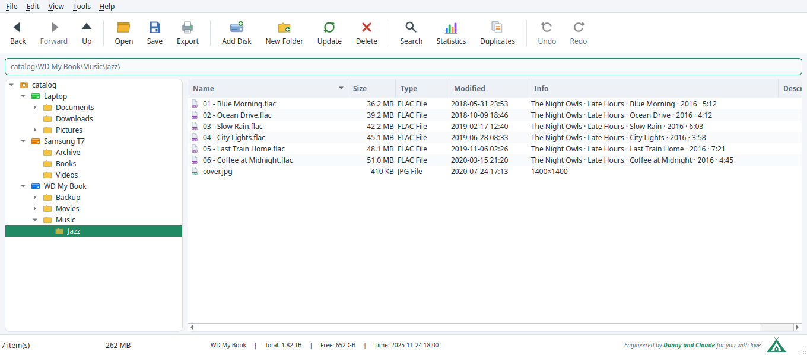
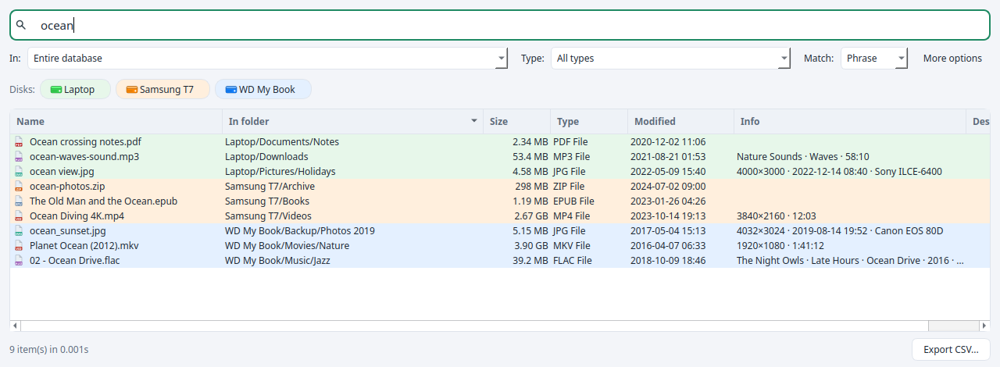
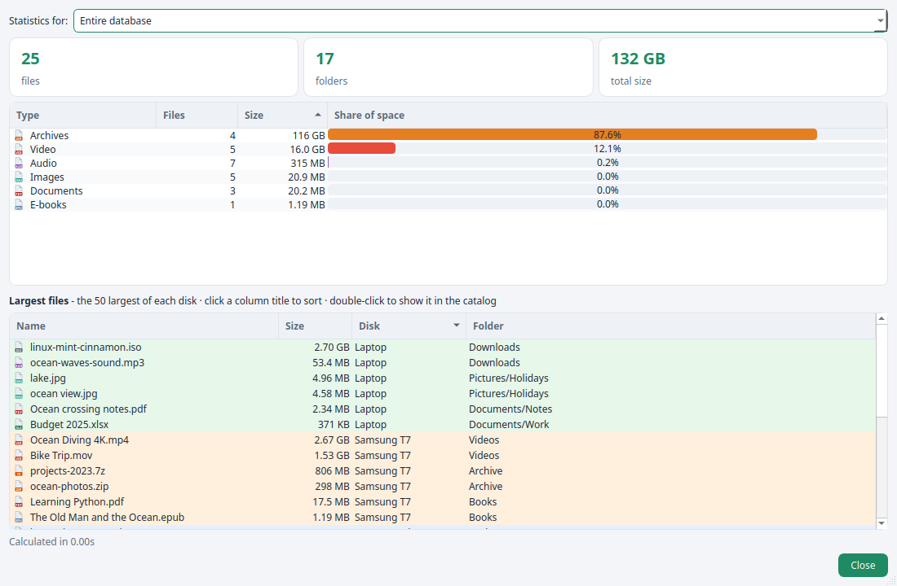

# Tent Cataloguer for Linux

Offline catalog of external and local disks: browse folder structure, sizes
and files without the disk connected, and find anything in milliseconds.
Python 3 + PyQt6 + SQLite.

### Instant search (Ctrl+F) - one color per disk

### Statistics - space per file type and the largest files of each disk

## Install (Debian/Ubuntu/Linux Mint) - recommended

Download `tent-cataloguer_2.0.8_all.deb` from the
[Releases page](https://github.com/DannyDi2/tent-cataloguer/releases), then
double-click it, or:

    sudo apt install ./tent-cataloguer_2.0.8_all.deb

It appears in the menu as **Tent Cataloguer**, and `.dcat` files open with it.
Uninstall with `sudo apt remove tent-cataloguer`.

### Alternative: pipx

    sudo apt install pipx git libxcb-cursor0
    pipx ensurepath

Close and reopen the terminal, then:

    pipx install "tent-cataloguer[media] @ git+https://github.com/DannyDi2/tent-cataloguer.git"

Update with `pipx upgrade tent-cataloguer`, uninstall with `pipx uninstall tent-cataloguer`.

### Build the .deb yourself

    packaging/build_deb.sh        # creates dist/tent-cataloguer_<version>_all.deb

## Features

- Catalog external drives, local folders and shares, then browse folder structure, sizes and files later with the disk disconnected
- **Instant search (Ctrl+F)**: results appear while you type; Enter shows all results
- **One background color per disk** in the results, so you see at a glance where a file is; disk chips work as legend and filter (right-click = only that disk); colors can be changed (Tools > Disk color)
- Wildcards (`*` `?` `#` `[abc]`), Phrase / All words / Any word modes, size and date filters
- **Filter by type**: video, audio, images, documents, e-books, archives, programs, code, subtitles, or your own extensions
- **Open / Play** from the right-click menu: plays songs (several at once become a playlist) or opens files with your default application (finds the disk even if it is mounted somewhere else)
- **Progress bar with percentage and time left** while reading or updating a disk
- **Statistics** (Ctrl+I): space used per file type and the largest files of each disk
- Every list can be sorted by any column (click the column title; click again to reverse)
- **Probable duplicates across disks** (Ctrl+Shift+D): same name and same size, even on disks that are not connected
- **Connected-disk detection**: when a catalogued disk is plugged in, the app offers to update its catalog
- Optional **archive contents**: files inside zip, tar (built in), rar, 7z, iso (with 7-Zip or PeaZip) are catalogued and searchable
- Optional **media info**: music tags, photo date/camera, video length and resolution (needs python3-mutagen, python3-pil, ffmpeg); searchable too
- Modern look with light and dark themes
- Descriptions on any item, included in searches
- CSV export
- Save / Save As, and multi-level Undo / Redo (up to 25 steps)
- Update Disk keeps your descriptions; unchanged archives and media files are not read again; items you delete can be remembered and ignored on future updates
- Unreadable items (for example I/O errors) are skipped and listed at the end of the scan; previously catalogued content of those folders is kept
- Command line: `tent-cataloguer-cli CATALOG.dcat scan|update|search|list|stats|dups|export-csv`

## Known limitations

- Developed and tested on Linux Mint with Python 3.12. Other distributions and desktop environments are untested.
- "Open file location" tries the D-Bus FileManager1 interface and falls back to opening the folder with Nemo or xdg-open. It also requires the disk to be mounted at the path recorded when it was scanned.
- Network shares have not been tested by the author.
- Connected-disk detection matches the filesystem UUID; shares without a UUID are not detected.
- Password-protected archives are catalogued as normal files.
- Undo keeps full snapshots of the catalog, so very large catalogs may use more memory.
- The .bxd format of Broken X Disk Manager is not supported.

## License

GPL-3.0, see the LICENSE file. PyQt6 is distributed under GPL v3 or a commercial license.
